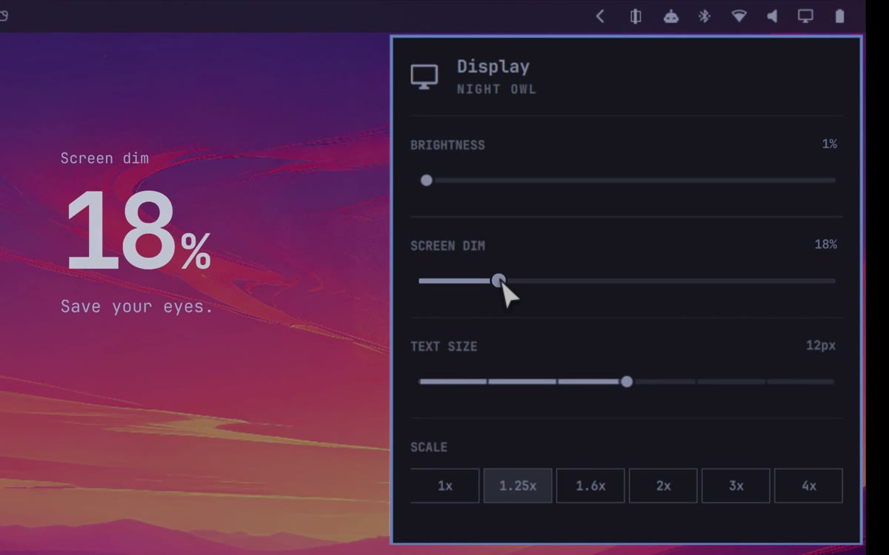

# Dim for Omarchy

Dim every display with a black overlay, toggle it from the bar, and adjust its strength from the display panel. This bundle includes the `oma.dim` service, the `oma.display` monitor widget, and the `oma.indicators` status widget.


If the player does not load, [open the demo video](docs/assets/dim-demo.mp4) or click this preview:

[](docs/assets/dim-demo.mp4)


## Install

If upgrading from an earlier install, first disable and remove any old IDs you have installed so their bar widgets and service do not run alongside Dim:

```sh
omarchy plugin disable jarvis.indicators && omarchy plugin remove jarvis.indicators
omarchy plugin disable jarvis.display && omarchy plugin remove jarvis.display
omarchy plugin disable jarvis.dim && omarchy plugin remove jarvis.dim
omarchy plugin disable jarvis.screendim && omarchy plugin remove jarvis.screendim
```

Run only the commands for IDs present on your system. Removing the old service does not remove the saved `screendim` strength setting.

Install the root plugin, then run its installer. It installs the `dim` command and both widgets, rescans Omarchy, and enables all three plugins. Omarchy replaces each matching built-in in place, keeping its bar position and settings; if a matching built-in is absent, Omarchy uses the widget's normal default placement.

```sh
omarchy plugin add https://github.com/yogeshsuryag/dim.git
"${XDG_CONFIG_HOME:-$HOME/.config}/omarchy/plugins/oma.dim/install"
```

If a different `dim` command is already installed, pass `--replace` to back it up before installing this one.

## Use

- Use the `dim` command to toggle dimming, check status, change strength, or enable and disable Dim:

```sh
dim toggle
dim status
dim strength 60
dim enable
dim disable
```

Run `dim` or `dim help` to see the command list. `dim status` shows whether Dim is enabled or dimming and reports its strength. `dim strength` shows the current strength; `dim strength 60` sets it from `0` to `100` while preserving the current on/off state, with `0` hiding the overlay. If `dim toggle` or `dim strength` reports `Dim is disabled. Run: dim enable`, run `dim enable` to enable all three plugins. `dim disable` turns the overlay off and disables the plugins while keeping their files and saved strength. The `dim` command is installed in `~/.local/bin`.

## Remove

Remove the widgets before removing the service they call:

```sh
omarchy plugin disable oma.indicators
omarchy plugin disable oma.display
omarchy plugin disable oma.dim
omarchy plugin remove oma.indicators
omarchy plugin remove oma.display
omarchy plugin remove oma.dim
```

Removing `oma.dim` does not remove the two companion folders or the saved state directory. Remove those separately if desired.

## License and attribution

The root `oma.dim` plugin is MIT licensed; see [LICENSE](LICENSE). Adapted Omarchy portions in the two companion plugins retain Omarchy's MIT copyright and license notice in [THIRD_PARTY_NOTICES.md](THIRD_PARTY_NOTICES.md). See [TECHNICAL.md](TECHNICAL.md) for details.
